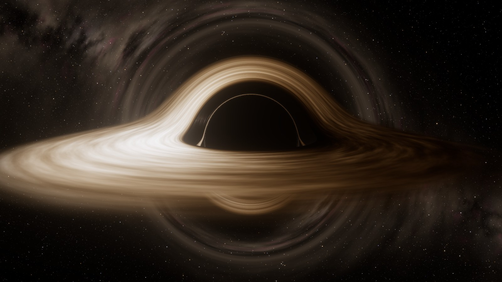

# Schwarzschild 黑洞 · 广义相对论实时光线追踪



一个**单文件**的浏览器黑洞模拟（`index.html`）：在 GPU 片元着色器中对每个像素沿 Schwarzschild 时空的零测地线反向追踪光线，
吸积盘、红移、相对论集束、背景星空的透镜像全部由物理公式实时计算。

## 运行

**直接双击 `index.html` 用浏览器打开即可**（无需安装、无需本地服务器）。

- 需要支持 WebGL2 的浏览器：Chrome / Edge / Firefox / Safari 16.4+，建议开启硬件加速。
- three.js r169 从 CDN 加载；页面会自动在 jsDelivr、unpkg、fastly/gcore jsDelivr 与 npmmirror 之间选择可访问的源。
- 首次打开时会在 GPU 上生成一次银河背景贴图（通常不到 1 秒）。

## 操作

| 操作 | 说明 |
| --- | --- |
| 左键拖动 / 单指拖动 | 旋转视角（OrbitControls） |
| 滚轮 / 双指捏合 | 缩放（改变观察者到黑洞的距离 r，最小 2.25M） |
| `H` | 隐藏 / 显示界面 |
| `空格` | 暂停 / 继续时间 |
| `R` | 重置视角 |
| `C` | 显示临界曲线 b = 3√3 M |

右侧面板可切换观察者运动状态、开关各项物理效应、调节吸积盘参数、画质与曝光。

## 物理模型

单位制 G = c = M = 1（视界 r = 2M，光子球 r = 3M，ISCO r = 6M）。

1. **度规**：ds² = −(1−2M/r)dt² + (1−2M/r)⁻¹dr² + r²dΩ²。
2. **光线**：每条光线位于过中心的平面内，零测地线方程化为 Binet 方程 `d²u/dφ² = −u + 3Mu²`（u = 1/r），
   用自适应步长 RK4 积分；用三次 Hermite 插值精确求出穿过赤道面（吸积盘）的半径和逃逸方向，
   因此盘的背面像、二阶 / 三阶像（光子环）自然出现。
3. **相机**：像素方向定义在局域静止观测者的正交标架中，径向分量按 √(1−2M/r) 换算，冲击参数 b = r sinψ/√(1−2M/r)。
   可选**开普勒圆轨道**（v = √(M/(r−2M))，可随轨道公转）或**自由下落**（v = √(2M/r)）观察者：像素方向经相对论光行差变换，
   频率乘以 1/[γ(1−β·n′)]。
4. **吸积盘**：Novikov–Thorne 薄盘，内边缘零力矩，Page–Thorne 通量
   `F ∝ [x − x₀ + (√3/2) ln((x+√3)(x₀−√3)/((x₀+√3)(x−√3)))] / (r^{5/2}(r−3M))`（x = √r，x₀ = √r_in），
   局域黑体 T ∝ F^{1/4}。气体沿圆测地线运动，Ω = √(M/r³)。
5. **红移**：`g = √(1−3M/r) / [√(1−2M/r_obs)(1 − Ω L_z/E)]`，L_z/E 由光线守恒量给出。
   由 I_ν/ν³ 不变性，温度 T 的黑体在观测者看来恰为温度 gT 的黑体，颜色由 Planck 谱 ⊗ CIE 1931 色匹配函数计算，
   亮度变化（多普勒集束）自动正确。可选 Chandrasekhar 电子散射临边昏暗 I(μ) ∝ 1 + 2.06μ。
6. **光行时延**：沿光线积分 dt/dφ = 1/[b u²(1−2Mu)]，盘面湍流图案取发射时刻的状态；湍流随局域开普勒角速度差动旋转。
7. **星空**：程序化银河（老年 / 年轻星族黑体谱、Hα/Hβ/[OIII] 发射线、尘埃消光，含大小麦哲伦云与仙女座星系）和约 50 万颗恒星。
   恒星作为点源，通过透镜映射的雅可比矩阵（像素方向的屏幕空间导数的 SVD）回投到屏幕，亮度随引力放大率变化且通量守恒；
   来自无穷远的光对静止观察者蓝移 1/√(1−2M/r)，颜色同样按黑体 / 谱线精确移动。

## 数值验证

```
node tools/verify_physics.js
```

脚本检查：Page–Thorne 闭式解与数值积分一致（相对误差 < 10⁻⁸）、通量峰值位于 r ≈ 9.55M、
自适应 RK4 的逃逸方向误差（主像光线 ≲ 1×10⁻⁵ rad，近临界光线 < 3×10⁻⁵ rad，均远小于一个像素）、
弱场偏折角与后牛顿展开 4M/b + 15πM²/(4b²) 一致、临界冲击参数 = 3√3 M。

## 近似与局限

- 不旋转（Schwarzschild）黑洞，无参考系拖曳；吸积盘为几何薄、光学厚的 Novikov–Thorne 盘。
- 湍流纹理是程序化噪声（按物理角速度平流），峰值温度是可调参数（真实值取决于黑洞质量和吸积率）。
- 辉光（bloom）与色调映射属于成像 / 显示环节，不是黑洞物理的一部分；可在面板中关闭或调节。

## URL 参数（可选）

所有面板参数都可通过 URL 设置，例如 `index.html?r=12&incl=75&observer=orbit&Tpeak=6000`。
另有 `incl`（相机极角，度）、`azim`（方位角，度）、`t`（初始坐标时）、`pause`、`noui`、`scale`（固定分辨率比例）、`lowsky`（低分辨率银河贴图）。
